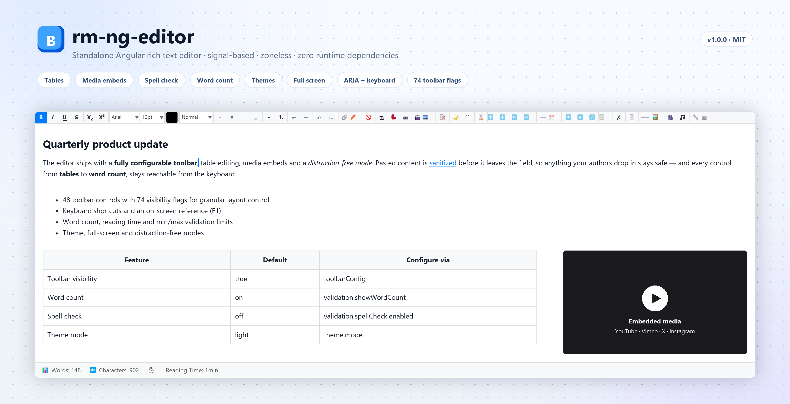
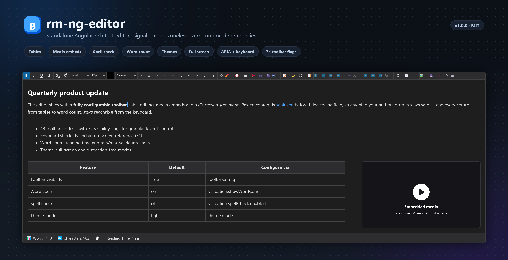

# rm-ng-editor

<p align="center">
  
  
  
  
  
  
  
  
  
  
  
  
  
  
  
  
  
  
</p>

<div align="center">
  <h3>
    <a href="https://www.npmjs.com/package/@codewithrajat/rm-ng-editor">View on npm</a>
    •
    <a href="https://github.com/malikrajat/rm-ng-editor">Source Code</a>
    •
    <a href="https://stackblitz.com/edit/stackblitz-starters-rt1ggozz">Try Demo</a>
    •
    <a href="./docs/README.md">Documentation</a>
  </h3>
</div>

<div align="center">
  <p style="margin: 16px 0; padding: 12px 20px; background: #f0f7ff; border-radius: 8px;">
    <strong>Lightning Fast</strong> - 
    <strong>Zero Dependencies</strong> - 
    <strong>Secure</strong> - 
    <strong>Well Documented</strong> - 
    <strong>Production Ready</strong>
  </p>
</div>


## See It In Action

<div align="center">

  

  <p><em>A high-performance rich text editor with customizable toolbar, tables, media embedding, spell check, and more!</em></p>

  <details>
    <summary><strong>Dark theme</strong></summary>

    

  </details>

</div>

---

`rm-ng-editor` is a lightweight, flexible, and tree-shakable Angular rich text editor (WYSIWYG) with **zero runtime dependencies beyond `tslib`**. Built and tested on Angular 22 (framework 22.0.4, CLI 22.0.5), with a declared peer dependency range of Angular 16–26, it delivers a full-featured editing experience — customizable toolbar, tables, media embedding, spell check, word count, link previews, full-screen mode, and more — plus zoneless support out of the box.

---

## Table of Contents

- [Installation](./docs/installation.md)
- [Quick Start / Usage](./docs/usage.md)
- [API Reference](./docs/api-reference.md)
- [Advanced Configuration](./docs/advanced-configuration.md)
- [Core Concepts](./docs/core-concepts.md)
- [Architecture](./docs/architecture.md)
- [Peer Dependencies](./docs/peer-dependencies.md)
- [Best Practices](./docs/best-practices.md)
- [Performance Optimization](./docs/performance-optimization.md)
- [Browser Support](./docs/browser-support.md)
- [Accessibility](./docs/accessibility.md)
- [Versioning & Breaking Changes](./docs/versioning-and-breaking-changes.md)
- [FAQ](./docs/faq.md)
- [Troubleshooting](./docs/troubleshooting.md)
- [Project Structure](./docs/project-structure.md)
- [Extending the Project](./docs/extending-the-project.md)
- [Changelog](./CHANGELOG.md)
- [License](./LICENSE)
- [Examples](./examples/README.md)

---

## Live Demo & Playground

<div align="center">

<table>
  <tr>
    <td align="center" width="50%">
      <a href="https://stackblitz.com/edit/stackblitz-starters-rt1ggozz" target="_blank">
        
      </a>
      <br/><br/>
      <sub><b>Interactive Playground</b></sub><br/>
      <sub>Try all features live in your browser</sub>
    </td>
    <td align="center" width="50%">
      <a href="https://github.com/malikrajat/rm-ng-editor/tree/main/examples" target="_blank">
        
      </a>
      <br/><br/>
      <sub><b>Complete Examples</b></sub><br/>
      <sub>Copy-paste ready code samples</sub>
    </td>
  </tr>
  <tr>
    <td align="center" width="50%">
      <a href="https://www.npmjs.com/package/@codewithrajat/rm-ng-editor" target="_blank">
        
      </a>
      <br/><br/>
      <sub><b>npm Registry</b></sub><br/>
      <sub>Install and view package details</sub>
    </td>
    <td align="center" width="50%">
      <a href="https://github.com/malikrajat/rm-ng-editor" target="_blank">
        
      </a>
      <br/><br/>
      <sub><b>Source Code</b></sub><br/>
      <sub>Star, fork, and contribute</sub>
    </td>
  </tr>
</table>

</div>

---

## Quick Start

### Installation

```bash
npm install @codewithrajat/rm-ng-editor
```

### Basic Usage

```typescript
import { Component, signal } from '@angular/core';
import { EditorConfig, RmNgEditor } from '@codewithrajat/rm-ng-editor';

@Component({
  selector: 'app-example',
  imports: [RmNgEditor],
  template: `
    <app-rm-ng-editor
      [value]="editorContent()"
      [config]="editorConfig"
      (valueChange)="editorContent.set($event)"
    >
    </app-rm-ng-editor>
  `
})
export class ExampleComponent {
  editorContent = signal('<p>Start typing here...</p>');

  editorConfig: EditorConfig = {
    placeholder: 'Write your content...',
    height: '400px',
    showToolbar: true,
    toolbarConfig: {
      showTextFormatting: true,
      showHeadings: true,
      showInsertLink: true,
      showInsertImage: true,
      showTable: true
    }
  };
}
```

`value` is a one-way signal input and `valueChange` is a signal output, so the editor never writes back to your state on its own — keep them in sync with the `[value]` + `(valueChange)` pair shown above.

---


## Features

- **Rich Text Editing**: Full WYSIWYG editing with bold, italic, underline, strikethrough, subscript, superscript, headings, font families, font sizes, text color, alignment, lists (ordered/unordered), and more
- **Customizable Toolbar**: Enable or disable individual toolbar groups and buttons through the `toolbarConfig` flags
- **Table Support**: Insert and edit tables with row/column operations, cell merging, splitting, and resizing
- **Media Embedding**: Embed YouTube, Vimeo, Twitter, Instagram, and custom iframe content directly into the editor
- **Link Management**: Insert, edit, and remove hyperlinks, with link previews
- **Spell Check**: Built-in spell checking with suggestions and a custom dictionary
- **Word & Character Count**: Real-time word count, character count (with/without spaces), and paragraph statistics
- **Full-Screen Mode**: Distraction-free editing with expandable full-screen support
- **Images**: Insert images by URL into the document
- **Undo/Redo**: Built-in history management for undo and redo operations
- **Content Sanitization**: Automatic HTML sanitization to prevent XSS and remove dangerous elements
- **Zoneless Ready**: Built with Angular's zoneless change detection in mind using signals and OnPush strategy
- **Accessibility**: Keyboard navigation, ARIA labels on the toolbar and content area, and focus management
- **SSR & AOT Compatible**: Works seamlessly with server-side rendering and ahead-of-time compilation
- **Zero Dependencies**: No runtime dependencies beyond Angular's peer packages and `tslib` — lightweight and tree-shakable
- **TypeScript**: Full type safety with comprehensive interfaces and type definitions
- **Angular Support**: Declared peer range `>=16.0.0 <=26.0.0` for `@angular/core` and `@angular/common`; built and tested on Angular 22 (framework 22.0.4, CLI 22.0.5)
- **Standalone Component**: Use without NgModules — fully compatible with Angular's standalone API

---

## Quick Start Guide

### 1. Installation

Choose your preferred package manager:

```bash
# npm
npm install @codewithrajat/rm-ng-editor

# pnpm
pnpm add @codewithrajat/rm-ng-editor

# yarn
yarn add @codewithrajat/rm-ng-editor
```

### 2. Basic Integration

#### Option A: Standalone Component (Recommended)

```typescript
import { Component, signal } from '@angular/core';
import { EditorConfig, RmNgEditor } from '@codewithrajat/rm-ng-editor';

@Component({
  selector: 'app-root',
  standalone: true,
  imports: [RmNgEditor],
  template: `
    <h1>My Rich Text Editor</h1>
    <app-rm-ng-editor
      [value]="content()"
      [config]="config"
      (valueChange)="content.set($event)"
    ></app-rm-ng-editor>
    <div>Current content: {{ content() }}</div>
  `
})
export class AppComponent {
  content = signal('<p>Welcome to <strong>rm-ng-editor</strong>!</p>');

  config: EditorConfig = {
    placeholder: 'Type your content here...',
    height: '400px',
    showToolbar: true,
    toolbarConfig: {
      showBold: true,
      showItalic: true,
      showUnderline: true,
      showFontControls: true,
      showTable: true,
      showValidation: true
    }
  };
}
```

#### Option B: Reactive Forms (manual bridge)

`RmNgEditor` does **not** implement `ControlValueAccessor`, so Angular's template-driven and reactive form directives cannot bind to `<app-rm-ng-editor>`. Bridge the `FormControl` with the `[value]` + `(valueChange)` pair:

```typescript
import { Component, inject } from '@angular/core';
import { JsonPipe } from '@angular/common';
import { FormBuilder, ReactiveFormsModule } from '@angular/forms';
import { EditorConfig, RmNgEditor } from '@codewithrajat/rm-ng-editor';

@Component({
  selector: 'app-form-editor',
  standalone: true,
  imports: [ReactiveFormsModule, JsonPipe, RmNgEditor],
  template: `
    <form [formGroup]="editorForm" (ngSubmit)="onSubmit()">
      <app-rm-ng-editor
        [config]="config"
        [value]="editorForm.controls.content.value ?? ''"
        (valueChange)="editorForm.controls.content.setValue($event)"
      ></app-rm-ng-editor>
      <button type="submit">Submit</button>
    </form>
    <pre>{{ editorForm.value | json }}</pre>
  `
})
export class FormEditorComponent {
  private fb = inject(FormBuilder);

  editorForm = this.fb.group({
    content: ['<p>Initial content</p>']
  });

  config: EditorConfig = {
    toolbarConfig: {
      showBold: true,
      showItalic: true,
      showTable: true
    }
  };

  onSubmit() {
    console.log('Form submitted:', this.editorForm.value);
  }
}
```

### 3. Common Use Cases

#### Blog Editor with Auto-Save

```typescript
import { Component, effect, signal } from '@angular/core';
import { EditorConfig, RmNgEditor } from '@codewithrajat/rm-ng-editor';

@Component({
  selector: 'app-blog-editor',
  standalone: true,
  imports: [RmNgEditor],
  template: `
    <app-rm-ng-editor
      [value]="blogContent()"
      [config]="blogConfig"
      (valueChange)="onContentChange($event)"
    ></app-rm-ng-editor>
    <div class="status">
      @if (isSaving()) {
        <span>Saving...</span>
      } @else if (isSaved()) {
        <span style="color: green;">✓ Saved</span>
      }
    </div>
  `
})
export class BlogEditorComponent {
  blogContent = signal('');
  isSaving = signal(false);
  isSaved = signal(false);
  private saveTimeout?: ReturnType<typeof setTimeout>;

  blogConfig: EditorConfig = {
    placeholder: 'Write your blog post here...',
    toolbarConfig: {
      showTextFormatting: true,
      showHeadings: true,
      showLists: true,
      showMediaEmbed: true,
      showLinkMedia: true,
      showTable: false
    }
  };

  constructor() {
    effect(() => {
      const content = this.blogContent();
      if (!content) {
        return;
      }

      this.isSaving.set(true);
      this.isSaved.set(false);

      clearTimeout(this.saveTimeout);
      this.saveTimeout = setTimeout(() => this.saveBlog(content), 1000); // Save after 1 second of inactivity
    });
  }

  onContentChange(content: string) {
    this.blogContent.set(content);
  }

  saveBlog(content: string) {
    // Save to your backend API
    console.log('Saving blog:', content);
    this.isSaving.set(false);
    this.isSaved.set(true);
  }
}
```

#### Comment Editor

```typescript
import { Component, signal } from '@angular/core';
import { EditorConfig, RmNgEditor } from '@codewithrajat/rm-ng-editor';

@Component({
  selector: 'app-comment-editor',
  standalone: true,
  imports: [RmNgEditor],
  template: `
    <app-rm-ng-editor
      [value]="commentContent()"
      [config]="commentConfig"
      (valueChange)="commentContent.set($event)"
      (wordCountChange)="wordCount.set($event.words)"
    ></app-rm-ng-editor>
    <button
      [disabled]="wordCount() < 10"
      (click)="submitComment()"
    >
      Post Comment
    </button>
    <div class="word-count">
      {{ wordCount() }} words
    </div>
  `
})
export class CommentEditorComponent {
  commentContent = signal('');
  wordCount = signal(0);

  commentConfig: EditorConfig = {
    placeholder: 'Share your thoughts...',
    toolbarConfig: {
      showTextFormatting: true,
      showLists: false,
      showTable: false,
      showMediaEmbed: false
    },
    validation: {
      showWordCount: true,
      maxWords: 500
    }
  };

  submitComment() {
    if (this.wordCount() >= 10) {
      // Submit comment
    }
  }
}
```

### 4. Advanced Configuration

```typescript
import { EditorConfig } from '@codewithrajat/rm-ng-editor';

config: EditorConfig = {
  placeholder: 'Start typing...',
  height: '500px',
  maxHeight: '600px',
  showToolbar: true,

  // Toolbar configuration
  toolbarConfig: {
    showTextFormatting: true,
    showScriptFormatting: true,
    showFontControls: true,
    showColorControls: true,
    showHeadings: true,
    showAlignment: true,
    showLists: true,
    showIndent: true,
    showUndoRedo: true,
    showLinkMedia: true,
    showMediaEmbed: true,
    showTable: true,
    showValidation: true,
    showViewMode: true,
    showAccessibility: true
  },

  // Validation and statistics
  validation: {
    showWordCount: true,
    maxWords: 1000,
    showCharacterCount: true,
    maxCharacters: 5000,
    showReadingTime: true,
    spellCheck: { enabled: true }
  },

  // Full-screen behaviour
  fullScreen: {
    enabled: true,
    hideToolbarInFullScreen: false,
    exitOnEscape: true,
    distractionFree: false
  }
};
```

`placeholder`, `height`, `maxHeight`, `showToolbar` and `disabled` are `EditorConfig` fields, not component inputs — configure them through `[config]`.

### 5. Programmatic Control

```typescript
import { Component, ViewChild } from '@angular/core';
import { RmNgEditor } from '@codewithrajat/rm-ng-editor';

@Component({
  selector: 'app-programmatic-control',
  standalone: true,
  imports: [RmNgEditor],
  template: `
    <app-rm-ng-editor #editor [config]="config"></app-rm-ng-editor>
    <button (click)="editor.focus()">Focus Editor</button>
    <button (click)="editor.execCommand('bold')">Bold</button>
    <button (click)="logContent()">Get Content</button>
    <button (click)="setContent()">Set Content</button>
  `
})
export class ProgrammaticControlComponent {
  @ViewChild('editor') editor!: RmNgEditor;

  config = { toolbarConfig: { showBold: true } };

  logContent() {
    console.log('Current content:', this.editor.getContent());
  }

  setContent() {
    this.editor.setContent('<p><strong>Hello</strong> World!</p>');
  }
}
```

Other content helpers on the component are `getTextContent()`, `isEmpty()`, `focus()`, `blur()` and `refreshWordCount()`.

### 6. Accessibility & Keyboard Shortcuts

The editor includes ARIA support:
- The toolbar exposes `role="toolbar"` with an `aria-label`, and the editable content area exposes `role="textbox"` with an `aria-label`
- The HTML-source and keyboard-shortcut dialogs are labelled with `aria-labelledby`
- Focus management returns focus to the editor when a dialog closes
- Full keyboard navigation, including the shortcuts listed below

**Keyboard Shortcuts:**
- `Ctrl+B` / `Cmd+B` - Bold
- `Ctrl+I` / `Cmd+I` - Italic
- `Ctrl+U` / `Cmd+U` - Underline
- `Ctrl+K` / `Cmd+K` - Insert Link
- `Ctrl+Z` / `Cmd+Z` - Undo
- `Ctrl+Y` / `Cmd+Y` - Redo
- `Ctrl+Shift+T` / `Cmd+Shift+T` - Insert Table
- `Ctrl+Enter` / `Cmd+Enter` - Page Break

---

## Code Examples

Explore our comprehensive examples to see the library in action:

| Example | Description | File |
|---------|-------------|------|
| **Basic Usage** | Simple rich text editor setup | [`examples/basic/basic-usage.ts`](./examples/basic/basic-usage.ts) |
| **Form Integration** | Bridge the editor to an Angular reactive form | [`examples/basic/form-integration.ts`](./examples/basic/form-integration.ts) |
| **Advanced Configuration** | Custom toolbar, full-screen, and validation | [`examples/advanced/advanced-configuration.ts`](./examples/advanced/advanced-configuration.ts) |
| **Content Processing** | Word count, sanitization, and heading extraction | [`examples/advanced/content-processing.ts`](./examples/advanced/content-processing.ts) |
| **Auto-Save** | Auto-save with debounce and lifecycle hooks | [`examples/async-and-lifecycle/auto-save.ts`](./examples/async-and-lifecycle/auto-save.ts) |
| **Error Handling** | Graceful error handling and recovery | [`examples/failure-cases/error-handling.ts`](./examples/failure-cases/error-handling.ts) |

[View All Examples](./examples/README.md)

---

## 📖 Documentation

| Documentation | Description |
|---------------|-------------|
| **[Installation Guide](./docs/installation.md)** | Step-by-step installation instructions |
| **[Usage Guide](./docs/usage.md)** | Comprehensive usage examples and patterns |
| **[API Reference](./docs/api-reference.md)** | Complete API documentation with all methods |
| **[Advanced Configuration](./docs/advanced-configuration.md)** | Custom toolbar, full-screen, and validation |
| **[Core Concepts](./docs/core-concepts.md)** | Understanding signals, zones, and change detection |
| **[Architecture](./docs/architecture.md)** | Internal architecture and design patterns |
| **[Best Practices](./docs/best-practices.md)** | Recommended patterns and anti-patterns |
| **[Performance Optimization](./docs/performance-optimization.md)** | Tips for faster, leaner bundles |
| **[Accessibility](./docs/accessibility.md)** | Keyboard, ARIA and screen-reader behaviour |
| **[Troubleshooting](./docs/troubleshooting.md)** | Common issues and solutions |

---

## Installation & Setup

For detailed installation instructions, see our [Installation Guide](./docs/installation.md).

---

## Usage

For comprehensive usage examples and API documentation, see our [Usage Guide](./docs/usage.md).

---

## Changelog

See [CHANGELOG.md](CHANGELOG.md) for release history and updates.

---

### Latest Release

Check the [releases page](https://github.com/malikrajat/rm-ng-editor/releases) for the most recent version and updates.

---

## License

This project is licensed under the MIT License - see the [LICENSE](LICENSE) file for details.

**TL;DR:** You can use this library freely in commercial and personal projects.


### MIT License Summary

**You can:**
- Use commercially
- Modify the code
- Distribute
- Use privately

**You must:**
- Include the license and copyright notice

**You cannot:**
- Hold the author liable

---

## FAQ

<details>
<summary><strong>What Angular versions are supported?</strong></summary>

The published package declares `@angular/core` and `@angular/common` as peer dependencies with the range `>=16.0.0 <=26.0.0`. The workspace itself is built and tested on Angular 22 (framework 22.0.4, CLI 22.0.5). The component uses signal inputs and outputs (`input()` / `output()`) and `viewChild.required`, which require Angular 17.2 or newer. See the [Versioning & Breaking Changes](./docs/versioning-and-breaking-changes.md) guide for the full matrix.

</details>

<details>
<summary><strong>Does this library have any external dependencies?</strong></summary>

**No.** `rm-ng-editor` has **zero external dependencies** beyond Angular's `@angular/core` and `@angular/common` peer dependencies (plus `tslib`). This keeps your bundle lean and avoids version conflicts. Everything — toolbar, spell check, tables, media embedding — is built from scratch.

</details>

<details>
<summary><strong>Is it compatible with Angular's zoneless change detection?</strong></summary>

**Yes, fully.** The editor uses `ChangeDetectionStrategy.OnPush`, Angular Signals, and `DestroyRef` for cleanup. It does not rely on `NgZone` or zone.js patching, making it a first-class citizen in zoneless Angular applications.

</details>

<details>
<summary><strong>Can I use this with Angular reactive forms or template-driven forms?</strong></summary>

Not directly. `RmNgEditor` does not implement `ControlValueAccessor`, so Angular's form directives cannot bind to `<app-rm-ng-editor>`. Use the manual bridge instead — bind the control's value to `[value]` and write it back from `(valueChange)`. See the [Form Integration example](./examples/basic/form-integration.ts) for a complete walkthrough.

</details>

<details>
<summary><strong>How do I customize which toolbar buttons appear?</strong></summary>

Pass a `toolbarConfig` object to the `[config]` input. Every toolbar group and button has its own `showX` flag — set it to `false` to hide that control. Example:

```typescript
import { EditorConfig } from '@codewithrajat/rm-ng-editor';

editorConfig: EditorConfig = {
  toolbarConfig: {
    showTextFormatting: true,
    showHeadings: true,
    showLists: true,
    showInsertTable: true,
    showStrikethrough: false,
    showSubscript: false,
    showSuperscript: false
  }
};
```

See [Advanced Configuration](./docs/advanced-configuration.md) for all options.

</details>

<details>
<summary><strong>Does the editor sanitize HTML to prevent XSS attacks?</strong></summary>

**Yes, automatically.** The editor strips `<script>`, `<object>`, `<embed>`, and `<iframe>` tags, and removes `on*` event handler attributes and `javascript:` URLs. You can also call `RmNgEditorService.sanitizeHtml()` programmatically. See [Content Processing](./examples/advanced/content-processing.ts) for details.

</details>

<details>
<summary><strong>Is the editor accessible?</strong></summary>

The editor implements accessibility features: keyboard navigation with shortcuts (Ctrl+B/I/U, Alt+1–6 for headings, F1 for the shortcut reference), `role="toolbar"` with an `aria-label` on the toolbar, `role="textbox"` with an `aria-label` on the editable area, `aria-labelledby` on the HTML-source and shortcuts dialogs, focus management (Escape closes a dialog or returns focus to the editor), and visible `:focus-visible` outlines on toolbar buttons.

**No formal WCAG audit has been performed or published for this library.** Treat the list above as the implemented baseline and run your own accessibility testing against your specific configuration and content before making a conformance claim. See [Accessibility](./docs/accessibility.md) for the full attribute reference, the known gaps (missing `aria-pressed` state, dialog focus handling, live-region status output) and app-side recipes that close them.

</details>

<details>
<summary><strong>Can I embed YouTube videos or tweets in the editor?</strong></summary>

**Yes.** The media embedding tool supports YouTube, Vimeo, Twitter/X, Instagram, and custom iframe embeds. Simply paste a URL or use the media toolbar button. Embedded content renders as a preview within the editor.

</details>

<details>
<summary><strong>How do I get the word count or character count?</strong></summary>

The editor emits `WordCountStats` from the `(wordCountChange)` output, and `RmNgEditorService` exposes the counting helpers too:

```typescript
import { WordCountStats } from '@codewithrajat/rm-ng-editor';

// Word count for an HTML string
const words = this.editorService.getWordCount(htmlContent);

// Full statistics through the component output
// <app-rm-ng-editor (wordCountChange)="onWordCountChange($event)" />
onWordCountChange(stats: WordCountStats) {
  // stats: { words, characters, charactersNoSpaces, paragraphs, sentences, readingTime }
}
```

Word count updates are **debounced** (default 100ms) to avoid performance overhead on every keystroke.

</details>

<details>
<summary><strong>Does it support server-side rendering (SSR)?</strong></summary>

**Yes.** The editor is SSR-safe — it uses Angular's `PLATFORM_ID` injection token to guard browser-only APIs (`document`, `window`, `MutationObserver`, etc.) and gracefully degrades on the server. It hydrates fully once the client bundle loads.

</details>

<details>
<summary><strong>How large is the bundle? Will it bloat my app?</strong></summary>

The library is **fully tree-shakable** with `sideEffects: false`. If you only import the component, unused services and utilities are stripped by your bundler.

</details>

<details>
<summary><strong>Can I use this in a standalone Angular component (no NgModules)?</strong></summary>

**Absolutely.** `RmNgEditor` is a standalone component — just add it to your component's `imports` array. No `NgModule` declarations needed.

</details>

<details>
<summary><strong>How do I report a bug or request a feature?</strong></summary>

- **Bug Reports**: [Open an issue](https://github.com/malikrajat/rm-ng-editor/issues/new?template=bug_report.md) with a minimal reproduction
- **Feature Requests**: [Submit a feature request](https://github.com/malikrajat/rm-ng-editor/issues/new?template=feature_request.md)
- **Discussions**: [Join GitHub Discussions](https://github.com/malikrajat/rm-ng-editor/discussions) for general questions
- **Email**: Reach out directly at [mr.rajatmalik@gmail.com](mailto:mr.rajatmalik@gmail.com?subject=rm-ng-editor%20Support)

</details>

<details>
<summary><strong>Is this library free for commercial use?</strong></summary>

**Yes.** Licensed under **MIT** — you can use it freely in commercial products, SaaS applications, and enterprise projects. You only need to retain the copyright notice. See the [License](#license) section for details.

</details>

<details>
<summary><strong>How does spell check work? Does it require an external service?</strong></summary>

The built-in spell checker runs entirely **client-side** — no external API calls. It uses the browser's native spellcheck capabilities combined with a custom dictionary. You can also provide your own dictionary of allowed/blocked words via the `validation` config.

</details>

<details>
<summary><strong>Can I save/restore the editor's undo history?</strong></summary>

The editor maintains an internal undo/redo stack. While the raw history stack isn't directly serializable, you can capture content snapshots at key moments and restore them. For auto-save patterns, see the [Auto-Save example](./examples/async-and-lifecycle/auto-save.ts).

</details>


---

## Performance Optimization

### Optimization Tips

#### 1. Defer the Editor Until It Is Needed

```typescript
import { Component, signal } from '@angular/core';
import { EditorConfig, RmNgEditor } from '@codewithrajat/rm-ng-editor';

@Component({
  selector: 'app-optimized-editor',
  standalone: true,
  imports: [RmNgEditor],
  template: `
    @defer (on viewport) {
      <app-rm-ng-editor
        [value]="content()"
        [config]="config"
        (valueChange)="content.set($event)"
      ></app-rm-ng-editor>
    } @placeholder {
      <p>Loading the editor…</p>
    }
  `
})
export class OptimizedEditorComponent {
  content = signal('');

  config: EditorConfig = {
    toolbarConfig: {
      showBold: true,
      showItalic: true,
      showTable: true
    }
  };
}
```

#### 2. Disable Toolbar Features You Do Not Use

```typescript
import { signal } from '@angular/core';
import { EditorConfig } from '@codewithrajat/rm-ng-editor';

export class OptimizedEditorComponent {
  content = signal('');

  config: EditorConfig = {
    toolbarConfig: {
      // Disable rarely used features
      showSpellCheck: false,
      showValidation: false,
      showMediaEmbed: false
    }
  };
}
```

Content changes, word counts and validation updates are already debounced inside the editor (100 ms), so no extra debouncing is needed on your side.

#### 3. Memory Management

```typescript
import { Component, DestroyRef, inject, signal } from '@angular/core';
import { EditorConfig, RmNgEditor } from '@codewithrajat/rm-ng-editor';

@Component({
  selector: 'app-memory-optimized',
  standalone: true,
  imports: [RmNgEditor],
  template: `
    <app-rm-ng-editor
      [value]="content()"
      [config]="config"
      (valueChange)="content.set($event)"
    ></app-rm-ng-editor>
  `
})
export class MemoryOptimizedComponent {
  private destroyRef = inject(DestroyRef);

  content = signal('');

  config: EditorConfig = {
    toolbarConfig: { showBold: true, showItalic: true }
  };

  constructor() {
    // The editor cleans up its own listeners, observers and timers on destroy.
    // Register your own cleanup alongside it:
    this.destroyRef.onDestroy(() => {
      // Remove your own listeners, timers or subscriptions here
    });
  }
}
```

---

## Testing Examples

### Unit Testing with Vitest

```typescript
import { ComponentFixture, TestBed } from '@angular/core/testing';
import { Component, signal } from '@angular/core';
import { RmNgEditor } from '@codewithrajat/rm-ng-editor';
import { vi } from 'vitest';

@Component({
  selector: 'test-host',
  standalone: true,
  imports: [RmNgEditor],
  template: `
    <app-rm-ng-editor
      [value]="content()"
      [config]="config"
      (valueChange)="onContentChange($event)"
    ></app-rm-ng-editor>
  `
})
class TestHostComponent {
  content = signal('<p>Test</p>');
  config = { toolbarConfig: { showBold: true } };
  onContentChange = vi.fn();
}

describe('RmNgEditor Component', () => {
  let fixture: ComponentFixture<TestHostComponent>;
  let hostComponent: TestHostComponent;

  beforeEach(async () => {
    await TestBed.configureTestingModule({
      imports: [TestHostComponent]
    }).compileComponents();

    fixture = TestBed.createComponent(TestHostComponent);
    hostComponent = fixture.componentInstance;
    fixture.detectChanges();
  });

  it('should create the component', () => {
    expect(hostComponent).toBeTruthy();
  });

  it('should render the editor host element', () => {
    const host: HTMLElement = fixture.nativeElement;
    expect(host.querySelector('app-rm-ng-editor')).toBeTruthy();
  });

  it('should render an editable content area', () => {
    const content: HTMLElement | null = fixture.nativeElement.querySelector('.editor-content');

    expect(content).toBeTruthy();
    expect(content?.getAttribute('contenteditable')).toBe('true');
  });
});
```

The workspace runs its unit tests with **Vitest** through the `@angular/build:unit-test` builder (`describe` / `it` / `expect` are globals, spies come from `vitest`).

### End-to-End Testing with Playwright

```typescript
import { test, expect } from '@playwright/test';

test('should show toolbar and accept input', async ({ page }) => {
  await page.goto('/editor');
  
  // Check if editor is visible
  await expect(page.locator('app-rm-ng-editor')).toBeVisible();
  
  // Check if toolbar is visible
  await expect(page.locator('.toolbar')).toBeVisible();
  
  // Type some content
  const editor = page.locator('.editor-content');
  await editor.fill('Hello World!');
  
  // Check content
  await expect(editor).toContainText('Hello World!');
});
```

---

## Migration Guide


### From Other Editors (Quill, TinyMCE, etc.)

#### Migrating from Quill

| Quill | rm-ng-editor |
|-------|--------------|
| `quill.getContents()` | `editor.getContent()` |
| `quill.root.innerHTML` | `editor.content()` |
| `quill.format()` | `editor.execCommand()` |
| `quill.getFormat()` | Check `editorState` signal |

#### Migrating from TinyMCE

| TinyMCE | rm-ng-editor |
|---------|--------------|
| `tinymce.get().getContent()` | `editor.getContent()` |
| `tinymce.get().setContent()` | `editor.setContent()` |
| `tinymce.get().execCommand()` | `editor.execCommand()` |

---

## Troubleshooting

### Common Issues

#### Issue: Editor content not updating
```html
<!-- Keep your own state in sync through the valueChange output -->
<app-rm-ng-editor
  [value]="content()"
  (valueChange)="content.set($event)"
></app-rm-ng-editor>
```

`value` is a one-way signal input, so passing it alone never reports edits back to you, and there is no two-way model binding behind it — use the explicit `[value]` + `(valueChange)` pair above.

#### Issue: Toolbar not showing
```typescript
// Check configuration
config = {
  showToolbar: true, // Must be true
  toolbarConfig: {
    showBold: true // At least one tool must be enabled
  }
};
```

#### Issue: Spell check not working
```typescript
import { EditorConfig } from '@codewithrajat/rm-ng-editor';

// Enable spell check in config
config: EditorConfig = {
  validation: {
    spellCheck: { enabled: true }
  }
};
```

---

## API Reference Quick Start

### Inputs

| Input | Type | Default | Description |
|-------|------|---------|-------------|
| `value` | `string` | `''` | Current editor content (HTML) |
| `config` | `EditorConfig \| null` | `null` | Editor configuration |

`placeholder`, `height`, `maxHeight`, `disabled`, `showToolbar`, `toolbarConfig`, `validation`, `theme`, `fullScreen` and `table` are **`EditorConfig` fields**, not component inputs — set them through `[config]`.

### Outputs

| Output | Type | Description |
|--------|------|-------------|
| `valueChange` | `string` | Emitted when the content changes |
| `focusEvent` | `void` | Emitted when the editor gains focus |
| `blurEvent` | `void` | Emitted when the editor loses focus |
| `stateChange` | `EditorState` | Emitted when the editor state changes |
| `wordCountChange` | `WordCountStats` | Word count statistics |
| `spellCheckResults` | `SpellCheckSuggestion[]` | Spell check suggestions |
| `fullScreenChange` | `boolean` | Emitted when full-screen mode toggles |
| `themeChange` | `string` | Emitted when the theme changes |
| `tableInsert` | `TableData` | Emitted when a table is inserted |
| `tableModify` | `TableData` | Emitted when a table is modified |

### Methods

| Method | Returns | Description |
|--------|---------|-------------|
| `execCommand(command, value?)` | `void` | Execute an editor command |
| `getContent()` | `string` | Get the current HTML content |
| `setContent(content)` | `void` | Replace the editor content |
| `getTextContent()` | `string` | Get the plain-text content |
| `isEmpty()` | `boolean` | Whether the editor is empty |
| `focus()` | `void` | Focus the editor |
| `blur()` | `void` | Blur the editor |

---

## Best Practices

### 1. Keep the Editor Value in Sync
```html
<!-- Recommended: one-way value plus the valueChange output -->
<app-rm-ng-editor
  [value]="content()"
  (valueChange)="content.set($event)"
></app-rm-ng-editor>
```

### 2. Sanitize User Input
```typescript
// The editor auto-sanitizes, but validate on backend too
const cleanContent = this.editorService.sanitizeHtml(dirtyContent);
```

### 3. Subscribe Only to the Outputs You Need
```html
<!-- Content changes arrive through valueChange; word count and validation
     updates are debounced internally (100 ms), so heavy work stays off the
     keystroke path. -->
<app-rm-ng-editor
  [value]="content()"
  (valueChange)="content.set($event)"
  (wordCountChange)="stats.set($event)"
></app-rm-ng-editor>
```

### 4. Use Angular Signals for Reactive Updates
```typescript
import { signal } from '@angular/core';
import { EditorConfig } from '@codewithrajat/rm-ng-editor';

content = signal('<p>Initial</p>');

config: EditorConfig = {
  toolbarConfig: { showBold: true }
};
```

---

## Documentation

- **[Installation Guide](./docs/installation.md)** - Detailed installation instructions
- **[Usage Guide](./docs/usage.md)** - Comprehensive usage examples
- **[API Reference](./docs/api-reference.md)** - Complete API documentation
- **[Advanced Configuration](./docs/advanced-configuration.md)** - Custom toolbar, full-screen, validation
- **[Architecture](./docs/architecture.md)** - Internal architecture and design patterns
- **[Best Practices](./docs/best-practices.md)** - Recommended patterns and anti-patterns
- **[Performance Optimization](./docs/performance-optimization.md)** - Performance tips and techniques
- **[Browser Support](./docs/browser-support.md)** - Supported browsers and versions
- **[Accessibility](./docs/accessibility.md)** - Keyboard, ARIA and screen-reader behaviour
- **[Versioning](./docs/versioning-and-breaking-changes.md)** - Version compatibility matrix

---

## Statistics

[](https://www.npmjs.com/package/@codewithrajat/rm-ng-editor)
[](https://www.npmjs.com/package/@codewithrajat/rm-ng-editor)
[](https://github.com/malikrajat/rm-ng-editor/issues)
[](https://github.com/malikrajat/rm-ng-editor/stargazers)
[](https://github.com/malikrajat/rm-ng-editor/blob/main/LICENSE)

---

## Support This Project

If **rm-ng-editor** has helped you build better Angular applications, please consider:

If this library has saved you development time and helped create amazing rich text editing experiences in your projects, **please consider giving it a  star!** 

 **Why star this repo?**
- Help other developers discover this lightweight, optimized solution
- Support continued development and improvements
- Show appreciation for free, quality tools
- Boost visibility in the Angular community
- Increases visibility in the Angular community
- Supports ongoing development and maintenance
- Encourages more open-source contributions
- Helps other developers find quality tools

###  **Want More Quality Libraries?**

This is just one of several useful libraries I've created. **[Explore my other Angular & web development libraries](https://github.com/malikrajat?tab=repositories)** that might solve your next challenge:

-  **Utility libraries** for common development tasks
-  **UI components** for better user experiences  
-  **Performance tools** for optimization
-  **Mobile-friendly solutions** for responsive apps

**Found them helpful?** A star on each repo you find useful helps tremendously! It takes just one click but means the world to open-source maintainers.

[](https://github.com/malikrajat?tab=repositories)
[](https://github.com/malikrajat)
[](https://github.com/malikrajat/rm-ng-editor/stargazers)

---

## Support and Community

### Getting Help

Need assistance? We're here to help!

| Support Channel | Link | Best For |
|----------------|------|----------|
| Bug Reports | [Report Bug](https://github.com/malikrajat/rm-ng-editor/issues/new?template=bug_report.md) | Technical issues |
| Feature Requests | [Request Feature](https://github.com/malikrajat/rm-ng-editor/issues/new?template=feature_request.md) | New features |
| Discussions | [Join Discussion](https://github.com/malikrajat/rm-ng-editor/discussions) | General questions |
| Email | [mr.rajatmalik@gmail.com](mailto:mr.rajatmalik@gmail.com?subject=rm-ng-editor%20Support) | Direct support |

### Documentation

- [GitHub Repository](https://github.com/malikrajat/rm-ng-editor)
- [npm Package](https://www.npmjs.com/package/@codewithrajat/rm-ng-editor)
- [Live Demo](https://stackblitz.com/edit/stackblitz-starters-rt1ggozz)
- [Changelog](https://github.com/malikrajat/rm-ng-editor/blob/main/CHANGELOG.md)

### Community

- Star the repository to show support
- Watch for updates and new releases
- Share your use cases and feedback
- Contribute code or documentation

### Stay Updated

- Follow the project on [GitHub](https://github.com/malikrajat/rm-ng-editor)
- Star the repository for updates
- Watch for new releases


---

## Acknowledgements

This library was created to provide a high-performance, feature-rich rich text editor for Angular applications.

Special thanks to:
- **[Angular Team](https://angular.io/)** - Amazing framework and ecosystem
- **Contributors** - Thank you for making this library better
- **Community** - For feedback and feature requests

---


## Other Libraries


### Monitoring & Diagnostics

| Library | Description | Link |
| --- | --- | --- |
| **@codewithrajat/rm-logvault** | Offline-first browser error tracking, logging and one-file diagnostics export. Redacts PII before writing, stores in IndexedDB, uploads only to your own endpoint. **Zero dependencies, tree-shakeable, framework-agnostic** — React, Vue, Angular, axios and TanStack Query adapters included. | [](https://github.com/malikrajat/rm-logvault) [](https://www.npmjs.com/package/@codewithrajat/rm-logvault) |

---

### UI Components

| Library                           | Description                                                              | npm Link                                                                                                        |
|-----------------------------------| ------------------------------------------------------------------------ | --------------------------------------------------------------------------------------------------------------- |
| **rm-range-slider**               | Lightweight two-thumb range slider with tooltips and color customization | [](https://www.npmjs.com/package/rm-range-slider)       |
| **rm-ng-range-slider**            | Angular-specific version of the dual range slider                        | [](https://www.npmjs.com/package/rm-ng-range-slider) |
| **rm-carousel**                   | Simple, responsive carousel component                                    | [](https://www.npmjs.com/package/rm-carousel)               |
| **rm-image-slider**               | Minimal image slider with smooth transitions                             | [](https://www.npmjs.com/package/rm-image-slider)       |
| **rm-ng-star-rating**             | Configurable Angular star rating component with readonly mode            | [](https://www.npmjs.com/package/rm-ng-star-rating)   |
| **@codewithrajat/rm-ng-typeahead** | Angular autocomplete/typeahead component with search suggestions and keyboard navigation | [](https://github.com/malikrajat/rm-ng-typeahead) |
| **@codewithrajat/rm-ng-editor**                  | Rich text editor component for Angular applications with customizable toolbar support | [](https://github.com/malikrajat/rm-ng-editor) |

---

### PDF & Export Libraries

| Library                                | Description                                                  | npm Link                                                                                                                                        |
| -------------------------------------- | ------------------------------------------------------------ | ----------------------------------------------------------------------------------------------------------------------------------------------- |
| **rm-ng-export-to-csv**                | Export JSON data to CSV with zero dependencies               | [](https://www.npmjs.com/package/rm-ng-export-to-csv)                               |
| **@codewithrajat/rm-ng-pdf-export**    | Image-based PDF export tool for Angular applications         | [](https://www.npmjs.com/package/@codewithrajat/rm-ng-pdf-export)       |
| **@codewithrajat/rm-ng-structure-pdf** | Generate structured PDFs for reports, invoices, or documents | [](https://www.npmjs.com/package/@codewithrajat/rm-ng-structure-pdf) |
| **@codewithrajat/rm-ng-pdf-viewer** | Angular PDF viewer component with zoom, navigation, and document rendering support | [](https://github.com/malikrajat/rm-ng-pdf-viewer) |

---

### Chrome Extension

| Library | Description | Link                                                                                                                                    |
|----------|-------------|-----------------------------------------------------------------------------------------------------------------------------------------|
| **quickocr** | Chrome extension that extracts text from images using OCR technology | [](https://github.com/malikrajat/quickocr/releases)                                     |
| **readLoude** | Chrome extension that read you web page loude e.g article etc. | [](https://github.com/malikrajat/readLoude/releases)                            |
| **ai-assistant-reply** | AI Chrome extension to auto generate reply on linked in posts. | [](https://github.com/malikrajat/ai-assistant-reply/releases) |

---

### VS Code Extension

| Library | Description | Link                                                                                                                                      |
|----------|-------------|-------------------------------------------------------------------------------------------------------------------------------------------|
| **dead-css-cleaner** | VS Code extension for identifying and cleaning unused CSS styles | [](https://github.com/malikrajat/dead-css-cleaner/releases)      |
| **file-coverage-insight** | VS Code extension for auto generated component file coverage automatelly on open. | [](https://github.com/malikrajat/file-coverage-insight/releases) |

---

### Desktop Applications - All Plateform

| Library | Description | Link                                                                                                                           |
|----------|-------------|--------------------------------------------------------------------------------------------------------------------------------|
| **deepwork** | Cross-platform productivity application for focus sessions and deep work tracking | [](https://github.com/malikrajat/deepwork/releases)          |
| **JsSandbox** | Cross-platform JavaScript playground and code execution environment | [](https://github.com/malikrajat/JsSandbox/releases) |

---

### Device Detection

| Library                        | Description                                             | npm Link                                                                                                                        |
| ------------------------------ | ------------------------------------------------------- | ------------------------------------------------------------------------------------------------------------------------------- |
| **rm-ng-device-detection**     | Detect device type, OS, and browser in Angular          | [](https://www.npmjs.com/package/rm-ng-device-detection)         |

---

### Notifications

| Library           | Description                                       | npm Link                                                                                              |
| ----------------- | ------------------------------------------------- | ----------------------------------------------------------------------------------------------------- |
| **rm-pushnotify** | Lightweight push-style toast notification utility | [](https://www.npmjs.com/package/rm-pushnotify) |
| **@codewithrajat/rm-toast-notification** | Cross-platform toast and desktop notification library for web, Angular, and desktop applications | [](https://github.com/malikrajat/rm-toast-notification) |


---

### Layout & Dynamic Rendering

| Library | Description | Link |
|----------|-------------|------|
| **rm-ng-dynamic-layout** | Dynamic layout rendering engine for Angular applications using JSON-driven UI configuration | [](https://github.com/malikrajat/rm-ng-dynamic-layout) |

---

### Developer Tools & Extensions

| Library | Description | Link                                                                                                                            |
|----------|-------------|---------------------------------------------------------------------------------------------------------------------------------|
| **rm-colorful-console-logger** | Structured and colorized console logging utility for developers | [](https://www.npmjs.com/package/rm-colorful-console-logger) |

---

### Meta & Personal Branding

| Library         | Description                                                      | npm Link                                                                                          |
| --------------- | ---------------------------------------------------------------- | ------------------------------------------------------------------------------------------------- |
| **about-rajat** | Developer portfolio package for branding and quick personal info | [](https://www.npmjs.com/package/about-rajat) |

---

### All Packages

Browse all my packages:
- [npm: @codewithrajat](https://www.npmjs.com/~codewithrajat)
- [npm: rajatmalik](https://www.npmjs.com/~rajatmalik)
- [GitHub: @malikrajat](https://github.com/malikrajat?tab=repositories)

---

## Author

**Rajat Malik**

Full‑Stack Developer and Frontend Architect at Siemens with 14+ years building scalable enterprise platforms, specializing in micro‑frontends, AI‑native development, React, and Angular.  
Author of 10+ open‑source libraries and 100+ technical articles, driving innovation through developer‑friendly tools, performance optimization, and AI‑assisted workflows.

### GET IN TOUCH

- Portfolio:  [rajatmalik.dev](https://rajatmalik.dev)
- Email:      [mr.rajatmalik@gmail.com](mailto:mr.rajatmalik@gmail.com)
- LinkedIn:   [errajatmalik](https://linkedin.com/in/errajatmalik)
- GitHub:     [@malikrajat](https://github.com/malikrajat)
- npm:        [rajatmalik](https://www.npmjs.com/~rajatmalik)

### SOCIAL PRESENCE
- Threads:    [rajatmalik](https://www.threads.net/@er.rajatmalik)
- Twitter/X:  [rajatmalik](https://x.com/er_rajatmalik)
- BlueSky:    [rajatmalik](http://devrajat.bsky.social)

### CONTENT & WRITING

- Medium:    [rajatmalik]( https://medium.com/@codewithrajat)
- Dev.to:    [rajatmalik]( https://dev.to/codewithrajat)
- Substack:   [rajatmalik](https://codewithrajat.substack.com)
- Hashnode:   [rajatmalik](https://hashnode.com/@codeswithrajat)

---

<p align="center">
  <p align="center">Made with care and love  by <a href="https://rajatmalik.dev">Rajat Malik</a> for the Angular community</p>
</p>

<p align="center">
  <a href="https://github.com/malikrajat/rm-ng-editor/stargazers">Star on GitHub</a> •
  <a href="https://www.npmjs.com/package/@codewithrajat/rm-ng-editor">View on npm</a> •
  <a href="https://github.com/malikrajat/rm-ng-editor/issues">Report Issue</a> •
  <a href="https://stackblitz.com/edit/stackblitz-starters-rt1ggozz">Try Demo</a>
</p>

<p align="center">
  Made with dedication by <a href="https://rajatmalik.dev">Rajat Malik</a>
</p>
